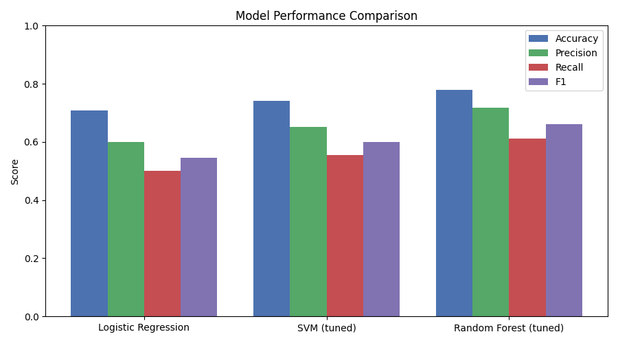
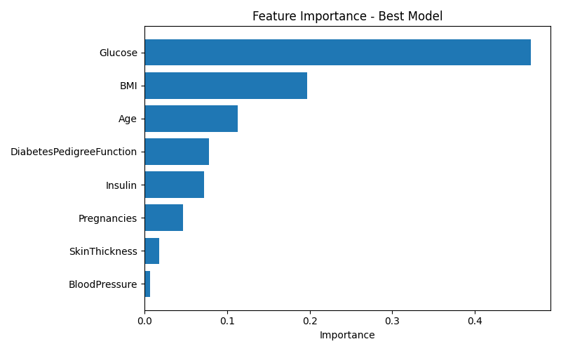
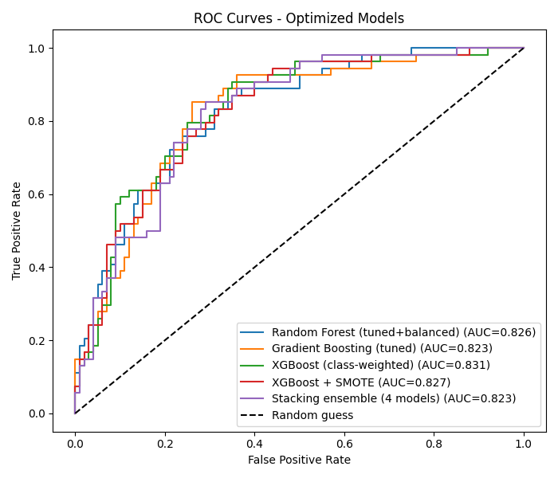
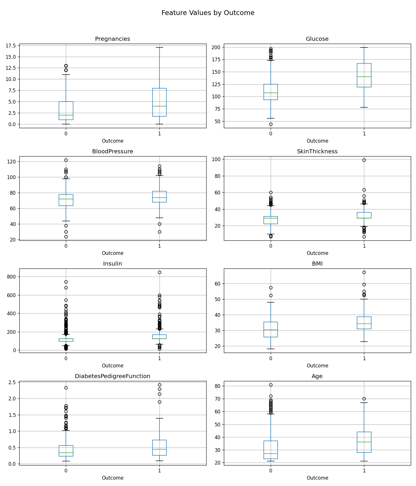
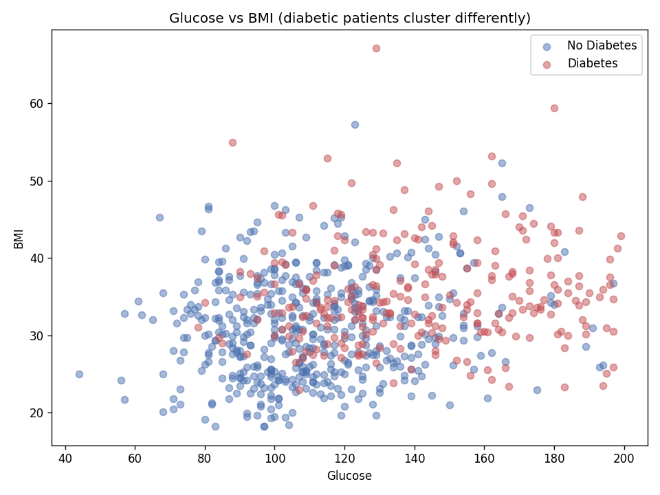

# Diabetes Risk Intelligence


A clinical-grade diabetes risk screening platform that combines **ADA 2026 / AHA-ACC 2025 clinical rules** with a **calibrated soft-voting machine learning ensemble** (Logistic Regression, SVM, Random Forest, Gradient Boosting, XGBoost) trained on the PIMA dataset.

Built as a **Next.js 14 + FastAPI monorepo**, deployed as a split architecture: Next.js frontend on Vercel, ML API in a container on Render. Hospital and lab systems can integrate results through **FHIR R4 / CDA** exports and a **scoped third-party API**.

> ⚠️ **Screening and education only — not a medical diagnosis.** Always confirm results with a clinician.

---

## Architecture

### System Architecture

```text
┌─────────────────────────────────────────────────────────────────────┐
│                      CLIENT — NEXT.JS (Vercel)                      │
│                                                                       │
│  ┌───────────────────────┐  HTTPS (same-origin)  ┌─────────────────┐ │
│  │  Next.js 14 + React   │  ──────────────────→  │  /api/v1/*      │ │
│  │  Tailwind + shadcn/ui │                       │  Proxied to      │ │
│  └───────────────────────┘                       │  Render API     │ │
│                                                 └─────────────────┘ │
│                                                                       │
│  State: TanStack Query, React Context, localStorage                   │
└─────────────────────────────────────────────────────────────────────┘
                           │
                           ▼
┌─────────────────────────────────────────────────────────────────────┐
│                    SERVER — RENDER (Free Tier, 512 MB)               │
│                                                                       │
│  ┌───────────────────────┐  uvicorn  ┌───────────────────────┐ │
│  │  FastAPI + Python 3.11│  ────────→  │  ML Ensemble Service  │ │
│  │  scikit-learn + XGBoost│           │  (5 models)           │ │
│  │  Platt sigmoid cali.  │           └───────────────────────┘ │ │
│  │  reportlab (PDF)      │                        │              │ │
│  └───────────────────────┘                        ▼              │ │
│                                                 ┌────────────────┐ │ │
│                                                 │  Neon Postgres │ │ │
│                                                 │  (optional)    │ │ │
│                                                 └────────────────┘ │ │
│                                                                       │
│  ┌───────────────────────┐                        ┌───────────────┐│ │
│  │  Upstash Redis        │                        │  Clerk Auth   ││ │
│  │  (rate limiting)      │                        │  (optional)   ││ │
│  └───────────────────────┘                        └───────────────┘│ │
│                                                                       │
│  Architecture Rationale:                                                     │
│  • Render free tier: 512 MB RAM — fits Python ML stack (~266 MB)          │
│  • Vercel serverless: caps bundles at ~500 MB — scikit-learn + XGBoost ~1 GB │
│  • Split deployment avoids bundling both runtimes in one environment       │
└─────────────────────────────────────────────────────────────────────┘

## ML Pipeline

### End-to-End Model Training Pipeline

```text
┌────────────────────────────────────────────────────┐
│              STEP 1: Data Ingestion                │
│  ┌────────────────────────────────────────────┐ │
│  │  PIMA Indians Diabetes Dataset (768 records)│ │
│  └────────────────────────────────────────────┘ │
│              │                                         │
│              ▼                                         │
│  ┌────────────────────────────────────────────┐ │
│  │  Step 2: Preprocessing & Feature Scaling     │ │
│  └────────────────────────────────────────────┘ │
│              │                                         │
│              ▼                                         │
│  ┌────────────────────────────────────────────┐ │
│  │  Step 3: Train 5 Base Models                 │ │
│  │  │  • Logistic Regression                    │ │
│  │  │  • SVM (RBF kernel)                       │ │
│  │  │  • Random Forest (n=100)                  │ │
│  │  │  • Gradient Boosting (n=100)              │ │
│  │  │  • XGBoost (native)                       │ │
│  └────────────────────────────────────────────┘ │
│              │                                         │
│              ▼                                         │
│  ┌────────────────────────────────────────────┐ │
│  │  Step 4: Soft Voting Ensemble (uniform weights)│ │
│  └────────────────────────────────────────────┘ │
│              │                                         │
│              ▼                                         │
│  ┌────────────────────────────────────────────┐ │
│  │  Step 5: Platt Sigmoid Calibration           │ │
│  │  └── calibrator.joblib                        │ │
│  └────────────────────────────────────────────┘ │
│              │                                         │
│              ▼                                         │
│  ┌────────────────────────────────────────────┐ │
│  │  Step 6: Split-Conformal 90% Intervals       │ │
│  │  └── q ≈ 0.696                               │ │
│  └────────────────────────────────────────────┘ │
│              │                                         │
│              ▼                                         │
│  ┌────────────────────────────────────────────┐ │
│  │  Step 7: Tree-SHAP Explanations (XGBoost native)│ │
│  │  └── pred_contribs (no external shap dep.)    │ │
│  └────────────────────────────────────────────┘ │
└─────────────────────────────────────────────────────────────┘
```

### Project Workflow

```mermaid
flowchart TD
    %% Styles
    classDef client fill:#e3f2fd,stroke:#1976d2,stroke-width:2px;
    classDef server fill:#f3e5f5,stroke:#7b1fa2,stroke-width:2px;
    classDef ml fill:#e8f5e9,stroke:#388e3c,stroke-width:2px;
    classDef api fill:#fff3e0,stroke:#f57c00,stroke-width:2px;
    classDef storage fill:#fafafa,stroke:#607d8b,stroke-width:1px,stroke-dasharray: 5 5;

    %% Client
    subgraph CLIENT["Client \nNext.js (Vercel)"]
        direction TB
        UI[UI: Screening Form]
        Query[TanStack Query]
        Storage[localStorage]
    end

    %% Server
    subgraph SERVER["Server \nRender (512 MB)"]
        direction TB
        FastAPI[FastAPI + uvicorn]
        Models[ML Ensemble \n5 models]
        Calibrator[Platt Calibrator]
        Conformal[Split-Conformal\n90% intervals]
        SHAP[Tree-SHAP\nXGBoost native]
        Postgres[Neon Postgres\n(optional)]
        Redis[Upstash Redis\n(rate limiting)]
        Clerk[Clerk Auth\n(optional)]
    end

    %% API
    subgraph API["API Layer\n/api/v1/*"]
        direction TB
        Proxy[Next.js Rewrites]
        Endpoints[API Endpoints]
    end

    %% Connections
    UI -->|Input data| Query
    Query -->|Form data| Proxy
    Proxy -->|HTTPS same-origin| Endpoints
    Endpoints -->|POST /screening| FastAPI
    FastAPI -->|Validate & rule check| Models
    Models -->|Predict scores| Calibrator
    Calibrator -->|Calibrated probability| Conformal
    Conformal -->|Interval + score| SHAP
    SHAP -->|SHAP values| FastAPI
    FastAPI -->|Response JSON| Endpoints
    Endpoints -->|JSON response| Proxy
    Proxy -->|HTTPS| Query
    Query -->|Update UI| Storage

    %% Storage connections
    FastAPI -->|Write| Postgres
    FastAPI -->|Read/Write| Redis
    FastAPI -->|Auth check| Clerk

    class CLIENT client
    class SERVER server
    class ML ml
    class API api
    classStorage storage
```

### Performance Metrics

| Model | F1 | AUC | Notes |
|-------|----|-----|-------|
| Gradient Boosting (baseline) | 0.592 | 0.823 | Fallback scorer |
| Soft-voting ensemble | 0.681 | 0.825 | Decision threshold 0.26 |
| **+ Platt calibration** (deployed) | **0.727** | **0.825** | Calibrated probability |
| Conformal interval (90%) | — | — | `q ≈ 0.696`, coverage 0.883 |

### Model Evaluation

---

## Tech Stack

| Layer | Technology | Notes |
|-------|------------|-------|
| **Frontend** | Next.js 14, React 18, TypeScript, Tailwind CSS, shadcn/ui | App Router, PWA-ready |
| **State** | TanStack Query (server), Zustand (client) | Server-state + client-cache |
| **Forms** | React Hook Form + Zod | Validation + error handling |
| **Backend** | FastAPI, Pydantic v2, uvicorn | OpenAPI docs auto-generated |
| **Database** | Neon Postgres (serverless, optional) | Scale-to-zero, pay-per-use |
| **Auth** | Clerk (optional) | JWT-based, social login |
| **Rate Limiting** | Upstash Redis (optional) | Token bucket algorithm |
| **ML** | scikit-learn, XGBoost (native `pred_contribs`) | Tree-SHAP without `shap` dep.; calibrated ensembe |
| **PDF** | reportlab (server), @react-pdf/renderer (client) | Clinical report generation |
| **PWA** | next-pwa (Workbox), idb | Offline support, push notifications |
| **Deploy** | Vercel (frontend) + Render (API) | Split architecture, free tiers |
| **CI/CD** | GitHub Actions | Lint, test, deploy pipelines |

---

## ML Model & Performance

**Architecture:** Calibrated soft-voting ensemble trained on the PIMA Indians Diabetes Database (768 records, 8 features).

- **Members:** Logistic Regression, SVM, Random Forest, Gradient Boosting, XGBoost
- **Calibration:** Platt sigmoid (`calibrator.joblib`)
- **Uncertainty:** Split-conformal 90% prediction intervals
- **Explanations:** Tree-SHAP values via XGBoost native `pred_contribs` — no external `shap` dependency

### Performance Metrics

| Model | F1 | AUC | Notes |
|-------|----|-----|-------|
| Gradient Boosting (baseline) | 0.592 | 0.823 | Fallback scorer |
| Soft-voting ensemble | 0.681 | 0.825 | Decision threshold 0.26 |
| **+ Platt calibration** (deployed) | **0.727** | **0.825** | Calibrated probability |
| Conformal interval (90%) | — | — | `q ≈ 0.696`, coverage 0.883 |

### Model Evaluation







---

## Project Structure

```
diabetes-prediction/
├── app/                          # Next.js 14 frontend
│   ├── src/
│   │   ├── app/                  # App Router pages
│   │   ├── components/           # UI, screening, charts, PDF
│   │   ├── lib/                  # API client, auth, validation
│   │   ├── hooks/                # React hooks
│   │   └── types/                # TypeScript types
│   ├── next.config.js            # Vercel rewrite config
│   └── package.json
├── api/
│   └── python/                   # FastAPI backend
│       ├── main.py               # Entry point
│       ├── config.py             # Pydantic settings
│       ├── routes/               # Route handlers
│       ├── services/             # Business logic
│       ├── models/               # Pydantic v2 models
│       ├── db/                   # asyncpg database layer
│       └── requirements.txt
├── scripts/
│   └── train_ensemble.py         # Model training
├── data/
│   └── processed/                # Model artifacts (joblib)
├── plots/                        # Evaluation visualizations
├── Dockerfile                    # Single-container build
├── api/python/Dockerfile         # API-only container build
├── render.yaml                   # Render Blueprint
├── docker-compose.yml            # Local Postgres + Redis
├── deploy/oracle/                # Oracle Always-Free VM bootstrap
├── docs/documentation.md         # Full documentation
├── turbo.json                    # Turborepo pipeline
└── package.json                  # Root workspace
```

---

## Getting Started

### Prerequisites

- Node.js 20+
- Python 3.11+
- Docker (optional, for local Postgres + Redis)

### 1. Clone

```bash
git clone https://github.com/sam-black007/diabetes-prediction.git
cd diabetes-prediction
```

### 2. Install Dependencies

```bash
# Frontend
cd app && npm install

# Backend
cd ../api/python && pip install -r requirements.txt
```

### 3. Configure Environment

```bash
cp .env.example .env
```

| Variable | Purpose | Required |
|----------|---------|----------|
| `API_INTERNAL_URL` | Backend URL for Vercel rewrite | Yes (split deploy) |
| `DATABASE_URL` | Neon Postgres connection string | No |
| `NEXT_PUBLIC_CLERK_PUBLISHABLE_KEY` | Clerk frontend key | No |
| `CLERK_SECRET_KEY` | Clerk backend key | No |
| `CLERK_ISSUER` | Clerk issuer URL | No |
| `CLERK_WEBHOOK_SECRET` | Svix webhook secret | No |
| `UPSTASH_REDIS_REST_URL` / `UPSTASH_REDIS_REST_TOKEN` | Rate limiting | No |
| `CRON_SECRET` | Cron endpoint protection | No |
| `MODEL_PATH` | Model artifact path | No |

### 4. Run Locally

**Backend:**
```bash
cd api/python
pip install -r requirements.txt
python -m uvicorn main:app --reload --port 8000
```

**Frontend:**
```bash
cd app
npm install
npm run dev
```

Open [http://localhost:3000](http://localhost:3000).

### 5. Run Tests

```bash
# Backend
cd api/python
pytest --cov=services --cov=routes

# Frontend
cd app
npm run lint
npm run typecheck
```

---

## Deployment

### Deployment Architecture

```text
┌─────────────────────────────────────────────────────────────────────┐
│                    SPLIT DEPLOYMENT (Recommended)                  │
│                                                                     │
│  ┌─────────────────────┐                    ┌─────────────────────┐ │
│  │  Vercel (Frontend)  │                    │  Render (API)       │ │
│  │  • Free Hobby tier  │                    │  • Free 512 MB tier │ │
│  │  • Next.js 14       │                    │  • FastAPI + Python │ │
│  │  • Serverless Fn    │                    │  • uvicorn          │ │
│  │  • Global CDN       │                    │  • 512 MB RAM limit │ │
│  └─────────────────────┘                    └─────────────────────┘ │
│                                                                     │
│  ──► same-origin proxy: /api/v1/* → Render API                      │
│                                                                     │
│  ┌─────────────────────┐                    ┌─────────────────────┐ │
│  │   CI/CD             │                    │   CI/CD             │ │
│  │  • GitHub Actions  │                    │  • GitHub Actions   │ │
│  │  • Vercel deploys  │                    │  • Render deploys   │ │
│  └─────────────────────┘                    └─────────────────────┘ │
│                                                                     │
│  **Cost:** $0 (both free tiers)                                    │
│  **Why split?** Render 512 MB fits Python ML (~266 MB);              │
│  Vercel caps bundles at ~500 MB; scikit-learn + XGBoost ~1 GB unpacked.│
│                                                                     │
└─────────────────────────────────────────────────────────────────────┘

### Option 2: Single Container (Self-Hosted)

For hosts with 2 GB+ RAM (e.g., Oracle Cloud Always-Free ARM):

```bash
docker build -t diabetes-prediction .
docker run -p 3000:3000 \
  --env ENVIRONMENT=development \
  --env DEV_AUTH_BYPASS=true \
  diabetes-prediction
# → http://localhost:3000
```

---

## API Reference

All endpoints are available under `/api/v1/`.

### Screening

| Method | Path | Description |
|--------|------|-------------|
| `POST` | `/api/v1/screening` | Full clinical screening |
| `GET` | `/api/v1/screening/{id}` | Get screening result |

**Request:**
```json
{
  "age": 54,
  "sex": "M",
  "glucose_mg_dl": 148,
  "sbp": 138,
  "dbp": 86,
  "height_cm": 175,
  "weight_kg": 88,
  "ldl_mg_dl": 142,
  "hdl_mg_dl": 38,
  "triglycerides_mg_dl": 190,
  "family_history": true
}
```

**Response:**
```json
{
  "id": "uuid",
  "health_score": 42,
  "risk_category": "very_high",
  "ml_result": {
    "score": 0.473,
    "shap_values": {
      "Pregnancies": 0.080,
      "Glucose": 0.372,
      "BloodPressure": -0.064,
      "SkinThickness": -0.065,
      "Insulin": -0.549,
      "BMI": -0.271,
      "DiabetesPedigreeFunction": 0.048,
      "Age": 0.587
    },
    "shap_base_value": 0.083
  }
}
```

### Health

| Method | Path | Description |
|--------|------|-------------|
| `GET` | `/api/v1/health` | Service health check |

Response: `{"status":"healthy","version":"2.0.0"}`

### Third-Party API

| Method | Path | Description |
|--------|------|-------------|
| `POST` | `/api/v1/third-party/api-keys` | Create API key |
| `POST` | `/api/v1/third-party/screening` | Screening via API key |
| `GET` | `/api/v1/third-party/history` | History via API key |

```bash
curl -H "Authorization: Bearer <api_key>" \
  https://<api-url>/api/v1/third-party/screening \
  -d '{"age":54,"sex":"M",...}'
```

---

## Contributing

### Contribution Workflow

```text
┌─────────────────────────┐                    ┌───────────────────────┐
│ 1. Fork repository      │                    │ 2. Clone locally      │
│    on GitHub            │                    │    `git clone ...`    │
│  └───────────────────────┘                    └───────────────────────┘
│                                                  │
│                                                  ▼
│                                            ┌───────────────────────┐
│                                            │ 3. Create branch      │
│                                            │    `git checkout -b  │
│                                            │    feature/your-feat`│
│                                            └───────────────────────┘
│                                                  │
│                                                  ▼
│                                            ┌───────────────────────┐
│                                            │ 4. Develop & test     │
│                                            │    - Run `pytest`     │
│                                            │    - Run `npm lint`   │
│                                            └───────────────────────┘
│                                                  │
│                                                  ▼
│                                            ┌───────────────────────┐
│                                            │ 5. Commit: `git commit│
│                                            │   -m "feat:..."`     │
│                                            └───────────────────────┘
│                                                  │
│                                                  ▼
│                                            ┌───────────────────────┐
│                                            │ 6. Push: `git push   │
│                                            │   origin feature/...`│
│                                            └───────────────────────┘
│                                                  │
│                                                  ▼
│                                            ┌───────────────────────┐
│                                            │ 7. Open Pull Request  │
│                                            │    on GitHub          │
│                                            └───────────────────────┘
│                                                  │
│                                                  ▼
│                                            ┌───────────────────────┐
│                                            │ 8. Maintainers review │
│                                            │    & merge            │
│                                            └───────────────────────┘
└─────────────────────────────────────────────────────────────┘
```

### Contributors

<table>
  <tr>
    <td align="center"><a href="https://github.com/sam-black007"><br /><sub><b>sam-black007</b></sub><br /><sub>SAM JOSEPH . B</sub></a></td>
    <td align="center"><a href="https://github.com/Thavina22"><br /><sub><b>Thavina22</b></sub><br /><sub>Thavina A</sub></a></td>
  </tr>
</table>

---

## License

MIT License — free to use, modify, and share.

---

## Medical Disclaimer

This tool provides **screening and education only — not a medical diagnosis**. Always confirm results with a clinician via fasting glucose / HbA1c testing per WHO and IDF guidance. Do not use this tool to make clinical decisions without professional medical supervision.

---
